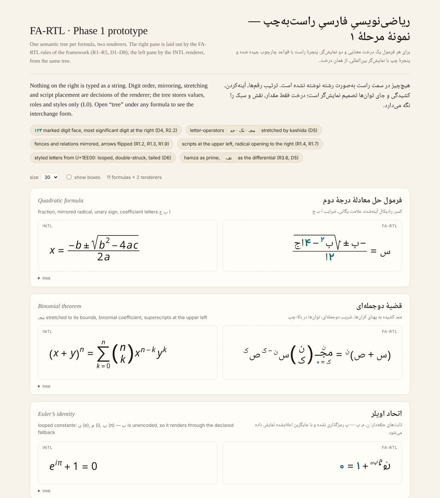

# FA-RTL — ریاضی‌نویسیِ فارسیِ راست‌به‌چپ

A notation for writing mathematics entirely in Persian script and Persian digits, flowing right to left, with no symbol whose identity derives from a Latin or Greek letter — built as a **presentation layer over a shared semantic tree**, so every expression round-trips losslessly to international notation.

This repository holds the **Phase 1 prototype**: a dependency-free layout engine that renders one semantic tree with two renderers (FA-RTL and INTL) to SVG, and a page showing ten canonical formulas side by side.



## Why

- Direction-coherent mathematics for a right-to-left script: digits, scripts, fences, big operators and matrices all follow one reading direction (framework decisions D1–D8).
- A research instrument: the notation is a controlled manipulation of presentation with the mathematics held fixed, which makes claims about reading direction and numerical cognition (SNARC, transcoding) testable.
- An adoption engine: Unicode encodes characters that communities already use. The editor this engine grows into is how the attestations get produced.

The full framework (layers L0–L7, decisions log, symbol registry, Unicode proposals U1–U3, research program) lives in a separate working document; this README summarizes only what the code implements.

## What the prototype implements

| Rule | Behaviour | Where |
| --- | --- | --- |
| D1, R2.2 | Numbers stored once, canonically (`1234.56`); the FA-RTL renderer places the most significant digit rightmost | `layNum` |
| D4 | Digits in a visibly marked face (Vazirmatn 600, teal); shapes never mirrored, numbers never stored reversed | `layNum`, page CSS |
| R2.4, R2.8 | Momayyez `٫` as decimal separator; scientific notation with the exponent at the upper left of `۱۰` | `toPersianDigits`, `layScripts` |
| R1.1 | Horizontal lists place the first item rightmost; unary signs precede their operand in reading order | `hlist`, `layRow` |
| R1.2, R1.3, R1.9 | Fences and relations mirrored, arrows flipped to reading direction | `MIRROR`, `OPS` |
| R1.4 | Super- and subscripts at the upper/lower **left** of the base | `layScripts` |
| R1.7 | Radical sign at the right, vinculum extending leftward, index at the upper right of the sign | `laySqrt` |
| R1.8, D5 | Letter-operators `مجـ` (∑), `تک` (∫), `حد` (lim) as joined naskh tokens stretched by kashida (U+0640) to the width of their bounds | `kashida`, `layBig`, `layLim` |
| R1.10 | Matrices with the first column at the right | `layMat` |
| R3.3, D8 | Identifier roles: `س ص ع` for x y z, `ا ب ج` for a b c, `ن م ک` for n m k, `ت` for f; looped `ن` `م` `پ` `ز` for e, i, π, φ; tailed letters for Greek roles | `ROLES` |
| R3.4, D6 | Looped, double-struck and tailed letters are the real U+1EE00 code points (Noto Sans Math); an unencoded combination (`پ` looped) renders through a declared fallback, never a silent substitution | `layId` |
| R3.6 | Hamza above as the prime (`تٔ`); `تف` as the differential token | `layPrime`, `layDiff` |
| R5.1, D7 | Classical function abbreviations (`جا جتا ظا …`) as shaped words | `NAMES` |

The INTL renderer reads the same tree and produces conventional notation (math-italic letters, ∑ ∫ lim, scripts at the right), which is the bijection of L0 made visible.

## Layout

```
src/engine.js     the layout engine: tree constructors, symbol tables, TeX-style box model, SVG output (~450 lines)
src/formulas.js   the ten canonical formulas (plus a numerals line) as semantic trees
src/page.html     the page template
build.py          inlines engine + formulas into dist/index.html and copies the fonts
test.js           Node smoke test: renders every formula in both directions with a heuristic measurer
dist/             the built page and its fonts (what is published)
docs/             screenshot
```

### Tree format

```js
const { N, V, O, R, F, SUP, SQRT } = FARTL.T;
// x = (−b ± √(b² − 4ac)) / 2a
R(V('x'), O('='), F(R(O('-'), V('b'), O('pm'), SQRT(R(SUP(V('b'), N(2)), O('-'), N(4), V('a'), V('c')))), R(N(2), V('a'))))
```

Node types: `num`, `id` (role + optional style), `op`, `row`, `frac`, `sup`/`sub`/`subsup`, `sqrt`, `big` (sum, int, prod with bounds), `lim`, `name`, `app`, `fence`, `mat`, `prime`, `diff`, `txt`. Identifiers carry roles, not letters; the role table decides the letter per renderer (L0.2).

### Engine API

```js
const engine = FARTL.createEngine(measure, { fonts, colors, size });
engine.render(tree, 'rtl', { size: 30, dbg: false }).svg;   // FA-RTL
engine.render(tree, 'ltr', { size: 30 }).svg;               // INTL
```

`measure(text, font, size)` returns `{ w, a, d }` (advance width, ink ascent, ink descent). The page uses canvas `measureText`; `test.js` uses a heuristic so the engine runs in Node.

## Build and test

```
npm install          # fonts only (fontsource packages)
node test.js         # renders 22 SVGs into out/
python3 build.py     # writes dist/index.html and dist/fonts/
```

Open `dist/index.html` in a browser. The page needs no server; the fonts load by relative path.

## Status and known limits

- Ordinary variables are drawn with plain naskh letters; plain-text export would use the isolated forms of the U+1EE00 block.
- The marked digit face is a sans design in colour, standing in for a dedicated mathematical digit style; the proposed strong-RTL digits (U1) do not exist yet, so plain-text export still needs the interim encoding.
- Spacing and sizes are first approximations, not a typesetting standard.
- No editing yet. Phase 3 is a structure editor over this tree with two renderers as style sheets, a Persian linear input syntax and an input method.

## Fonts and license

Code: MIT (see `LICENSE`).

Fonts shipped in `dist/fonts/` are under the SIL Open Font License 1.1 (see `dist/fonts/LICENSES/`): Noto Naskh Arabic (letters, shaped tokens, kashida), Vazirmatn (the marked digit face), Noto Sans Math (symbols, INTL letters, the U+1EE00 Arabic Mathematical Alphabetic Symbols).
